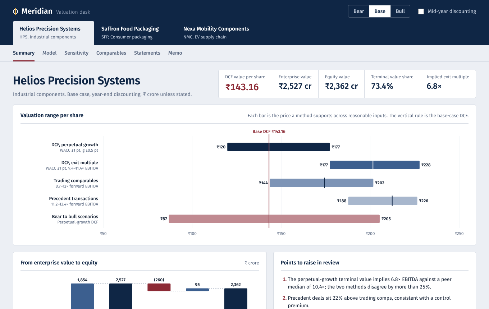
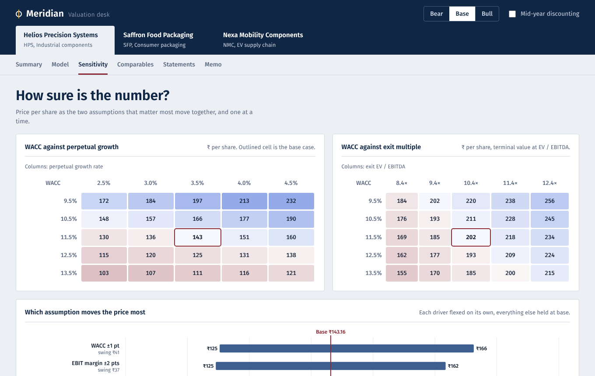

# Meridian — valuation desk

**Live demo:** https://meridian-investment-valuation.vercel.app

**New to the subject?** Start with the [plain-English guide](https://meridian-investment-valuation.vercel.app/guide.html) ([source](guide.html)): live figures from the model, a tab-by-tab tour, an exploration checklist, a capability checklist, common questions and a glossary, written for readers with no finance background.

**Excel model:** [`excel/Meridian_Valuation_Model.xlsx`](excel/README.md) is the same valuation as a live Excel model, with 776 formulas, dropdown case selection, `SUMPRODUCT` sensitivity grids, a football-field chart and linked three statements. It is recalculated and checked against this app in all 18 company × scenario × discounting cases: 1,998 values, 0 mismatches.

An equity valuation workbench laid out like a bank pitch book. It values three fictional Indian mid-caps with a five-year unlevered DCF, trading comparables and precedent transactions, then shows how sure the answer is.



## What it does

| View | What you get |
|---|---|
| **Summary** | Football field of value per share across five methods (perpetual-growth DCF, exit-multiple DCF, trading comps, precedents, bear-to-bull scenarios); enterprise-to-equity bridge; review points the model raises itself (e.g. when the perpetual-growth terminal value implies a multiple far from peers). |
| **Model** | Editable assumptions in the banking convention of blue inputs and black formulas; a CAPM WACC build with a one-click "use this WACC"; a full five-year UFCF build (revenue → EBITDA → EBIT → NOPAT → UFCF → PV) with negatives in brackets; EBITDA-to-free-cash-flow waterfall; CSV export. |
| **Sensitivity** | WACC × perpetual growth and WACC × exit multiple price grids; a tornado chart ranking seven drivers by how far they move the price. |
| **Comparables** | Peer table with growth and margin context, precedent deals, implied value per share for every observation. |
| **Statements** | A linked income statement, cash flow statement and balance sheet driven by the same forecast, with interest, debt repayment and dividends as inputs. The sheet balances every year. |
| **Memo** | An investment-committee note generated from the live model; downloadable. |

Every view responds to the **Bear / Base / Bull** switch and the **mid-year discounting** toggle in the header.



## Method

- Revenue growth and EBIT margin move linearly from year 1 to year 5. `UFCF = EBIT × (1 − t) + D&A − capex − ΔNWC`.
- Terminal value by Gordon growth, `UFCF₅ × (1 + g) / (WACC − g)`, or by exit multiple, `EBITDA₅ × multiple`. Each method reports what it implies about the other.
- `Equity value = EV − debt + cash`; value per share on diluted shares.
- WACC from CAPM: `Kₑ = r_f + β × ERP`, `K_d(1 − t)`, weighted by target debt to capital.
- Football-field DCF ranges use the inner 3 × 3 of each sensitivity grid (WACC ±1 pt and g ±0.5 pt, or multiple ±1×).

## Run it

```bash
python3 -m http.server 8080   # then open http://localhost:8080
npm test                      # Node 20+; no dependencies to install
```

Static site, no build step, no external requests (fonts are self-hosted).

## Project structure

```
index.html          markup for all six views
css/app.css         the whole visual system
src/engine.js       DCF, multiples, scenarios, WACC, tornado, three statements; pure functions
src/app.js          UI wiring and rendering
src/charts.js       small dependency-free SVG chart kit
src/dom.js          formatting and routing helpers
tests/              node:test suite for the engine
fonts/              Fira Sans (SIL Open Font Licence)
```

## Tests

12 engine tests, including: the forecast and discounting maths; EV/equity/per-share reconciliation; Gordon and exit-multiple terminal values round-tripping through the implied multiple and implied growth; value falling with WACC and rising with growth; the CAPM build landing within 0.3 points of each company's WACC; bear < base < bull for every company; sensitivity grids centred on the base case; every tornado bar straddling the base value; the linked statements balancing and reconciling cash in every year; and the exit multiple rounding half-up as Excel does (a bug found by the Excel reconciliation).

---

Independent case study by Nishant Khanke. Companies, peers and transactions are fictional; nothing here is a recommendation or a fairness opinion.
